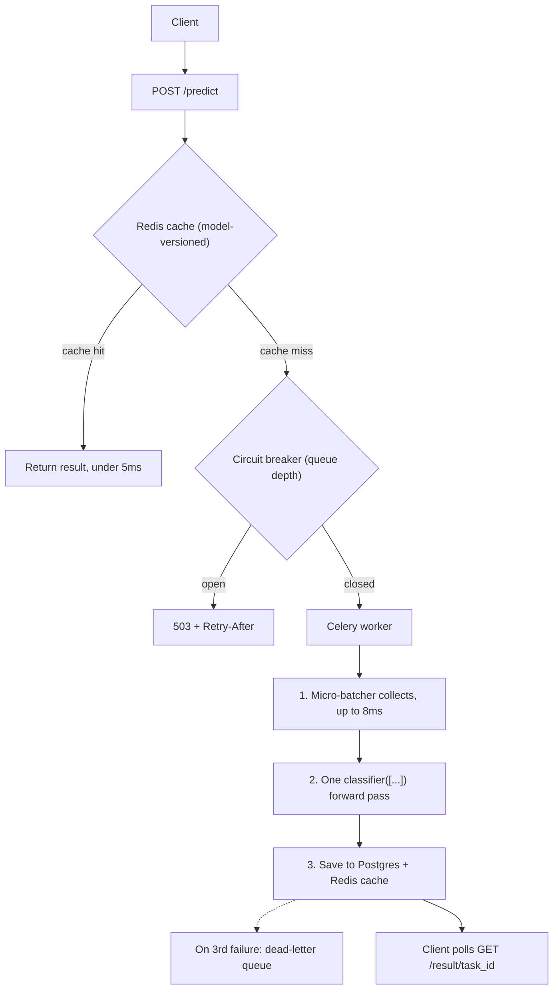

# ClearText — Asynchronous ML Serving Infrastructure


ClearText is an async inference platform that serves a slow ML model to many concurrent users without falling over. A BERT toxicity classifier is the example workload, but the actual project is the serving layer around it: request batching, model-versioned caching, a circuit breaker, and a dead-letter queue.

Built with FastAPI, Celery, Redis, PostgreSQL, and HuggingFace Transformers.

---

## The problem

A BERT model takes 150–300ms to classify one comment on CPU. Fine for one request. Not fine for 500 concurrent ones: a web server has a fixed number of threads, and if each is blocked for 250ms waiting on inference, the whole API stops answering, including endpoints that have nothing to do with the model.

The fix is to stop making the caller wait. `POST /predict` never runs the model inline. It enqueues the job with Celery and returns a task ID in a couple of milliseconds. A separate worker process picks the job up, runs inference, and the caller polls `GET /result/{id}` for the answer. The API and the worker are two independent processes connected only through Redis, so the slow part can never block the fast part.

Everything else in this project, the batching, the caching, the circuit breaker, the dead-letter queue, exists to make that handoff hold up under real load and real failures.

---

## Request flow



Job status moves `queued → processing → completed`, or `failed` after 3 retries with exponential backoff, at which point the job lands in the dead-letter queue instead of disappearing.

---

## Design decisions

**Request batching.** Multiple Celery threads can be classifying text at once. A background thread in the worker collects whatever requests arrive within an 8ms window (up to 16 of them) and runs them as a single model forward pass instead of one at a time. A batch of 16 costs barely more than a batch of 1, so this is close to free throughput. It's safe because the model is deterministic: a batched result is identical to running each input alone.

**Model-versioned cache.** The Redis cache key is a hash of `(model_version, text)`, not just the text. Swap the model version and every old cache entry becomes unreachable automatically. No manual flush, no risk of serving an answer from a model that's no longer running.

**Circuit breaker.** Before enqueueing a job, the API checks how long the queue is. If the backlog is over the limit (100 jobs by default), `/predict` returns `503` with a `Retry-After` header instead of making the line longer. Cache hits are still served while the breaker is open.

**Dead-letter queue.** A job that fails 3 times (with 1s/2s/4s backoff between attempts) isn't dropped. The original text, the error, and the full traceback get pushed to a Redis list. `/dlq` lists them, `/dlq/{id}/replay` re-runs one.

---

## Tech stack

- **API:** FastAPI, Python 3.11
- **Queue:** Celery + Redis
- **Database:** PostgreSQL, SQLAlchemy, Alembic migrations
- **Model:** `unitary/toxic-bert` (HuggingFace). The example workload; the serving layer itself is model-agnostic.
- **Testing:** pytest, 18 tests, one against a real Postgres instance
- **CI/CD:** GitHub Actions
- **Containers:** Docker + docker-compose, 4 services (API, worker, Postgres, Redis)

---

## API

| Method | Endpoint | Description |
|--------|----------|-------------|
| POST | `/predict` | Submit text for toxicity analysis |
| GET | `/result/{task_id}` | Fetch a prediction result |
| GET | `/dlq` | List dead-letter queue entries |
| POST | `/dlq/{task_id}/replay` | Re-enqueue a failed job |

---

## Running it

**One command:**

```bash
./demo.sh
```

Starts the stack, submits a sample comment, polls until the worker returns the result, then tails the logs. Pass `--rebuild` to force a clean rebuild.

**Docker, manually:**

```bash
docker compose up --build
```

API docs at http://localhost:8000/docs.

**Without Docker** (Python 3.11+ required, Postgres/Redis still via Docker):

```bash
git clone https://github.com/AshrafAhmed9/cleartext-api.git
cd cleartext-api
cp .env.example .env
docker compose up -d postgres redis
pip install -r requirements.txt
alembic upgrade head
celery -A core.celery_app worker --loglevel=info --pool=threads   # terminal 1
uvicorn api.main:app --reload                                      # terminal 2
```

Open `http://localhost:8000/docs`.

---

## Testing

```bash
pytest tests/ -v
```

18 tests covering predictions, cache versioning, the circuit breaker, the micro-batcher, the dead-letter queue, and worker tasks. One test writes to and reads back from a real Postgres instance; the rest mock Redis. CI runs the same suite against Postgres in GitHub Actions.

---

## Project structure

```
api/            FastAPI app: /predict, /result, DLQ endpoints
worker/         Celery task, model inference, micro-batcher
core/           Shared config, Celery setup, cache, circuit breaker
db.py           Prediction model, engine, session
migrations/     Alembic, two revisions, honest schema history
tests/          18 tests
.github/        CI workflow
```
